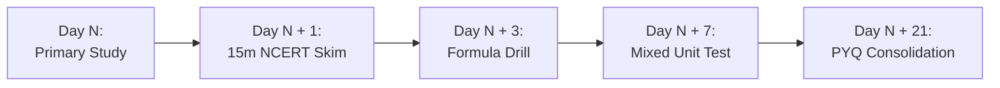

<div align="center">

# 🩺 NEETFlow
### Open-Source Dynamic Timeline Planner & Spaced-Prep Engine for NEET Aspirants

[](https://www.python.org/)
[](LICENSE)
[](#zero-external-dependencies)
[](#curriculum-coverage)

<p align="center">
  <b>Crack NEET (720 Marks) in your customized timeline (6 months, 3 months, or custom).</b><br>
  Calculates exact subject-wise daily study hours, injects automated spaced repetition revisions, and provides an interactive test arena with +4 / -1 NEET grading and an automated Mistake Notebook.
</p>

</div>

---

## 🌟 The Problem & The Solution

- **The Problem:** NEET aspirants face **97 vast chapters** across 4 distinct subjects (Botany, Zoology, Physics, Chemistry). Most students don't know how to distribute their daily hours according to exam mark weightage, fail to revise on time, and repeat the same mistakes on mock tests.
- **The NEETFlow Solution:** 
  1. **Fully Customizable Timeline Engine:** Reverse-engineers all 97 chapters into any custom timeline of **$n$ days** (e.g., 45 days, 75 days, 90 days, 120 days, 180 days, or custom) with live month conversion and click-to-edit capabilities.
  2. **High-Yield First (Day 1 High to Low Weightage):** Prioritizes Botany and Zoology (and all 4 subjects) starting on Day 1 with high-weightage chapters (Genetics, Cell Bio, Animal Kingdom, Reproduction) down to low-yield chapters.
  3. **Subject Hour Guide:** Automatically divides your available daily hours (e.g., 10 hrs/day) according to the 720-mark NEET weightage.
  4. **Spaced Repetition Scheduler:** Automatically schedules Day +1, Day +3, Day +7, and Day +21 revision checkpoints for every studied chapter.
  5. **Interactive Test Arena:** Practice multiple-choice and write-in/recall questions with official **+4 / -1 marking**, live countdown timers, and detailed NCERT explanations.
  6. **Automated Mistake Notebook:** Every wrong answer is automatically cataloged with explanations for targeted re-testing before exam day.

---

## 🎯 4-Subject Mark & Daily Hour Distribution (720 Marks)

NEET awards 4 marks per question across 180 questions (Total = 720 Marks). NEETFlow calculates study hours based on this proven formula:

| Subject | NEET Marks | Questions | Daily Allocation (10h Routine) | Focus Strategy |
| :--- | :---: | :---: | :---: | :--- |
| 🌿 **Botany** | **180** | 45 | **1.75 Hours** | NCERT line-by-line reading, tables & plant kingdom charts |
| 🧬 **Zoology** | **180** | 45 | **1.75 Hours** | Human physiology organ systems, hormonal pathways & diagrams |
| ⚡ **Physics** | **180** | 45 | **2.50 Hours** | 45m concept theory + 30–40 numerical problem-solving |
| 🧪 **Chemistry** | **180** | 45 | **2.50 Hours** | Organic GOC mechanisms, Inorganic memorization, Physical formulas |
| 🔁 **Spaced Revision & Test** | — | — | **1.50 Hours** | Day +1, +3, +7, +21 review checkpoints & error notebook drills |
| **Total** | **720** | **180** | **10.0 Hours/Day** | **70.0 Hours / Week** |

---

## 🚀 Quick Start (Runs in 5 Seconds)

> [!NOTE]
> **Zero External Dependencies!** NEETFlow runs entirely using standard Python 3.10+ and modern HTML5/Tailwind via CDN. No `npm install` or `pip install` required.

### 1. Clone the repository
```bash
git clone https://github.com/your-username/NEET.git
cd NEET
```

### 2. Run the Web Application
```bash
python3 app.py
```
Open your browser and navigate to:
```
👉 http://localhost:8000
```

---

## 💻 Command-Line Interface (CLI)

Prefer the terminal? NEETFlow includes a full-featured CLI:

```bash
# 1. View tasks scheduled for today or any specific day
python3 cli.py tasks --day 1

# 2. Calculate daily study hours breakdown based on your capacity (e.g., 8h, 10h, 12h)
python3 cli.py guide --hours 10

# 3. Take an interactive terminal quiz (+4 / -1 grading)
python3 cli.py quiz --subject Physics

# 4. View unresolved questions in your Mistake Notebook
python3 cli.py mistakes

# 5. Generate a brand new custom timeline
python3 cli.py new --days 180 --hours 10
```

---

## 🧠 Spaced Repetition (The 1-3-7-21 Algorithm)

Human memory decays according to Ebbinghaus's Forgetting Curve. When a student completes a chapter on Day $N$, NEETFlow automatically schedules:



If a student scores below 75% during revision tests, the chapter automatically flags for re-review in the Mistake Notebook.

---

## 📁 Repository Structure

```
NEET/
├── README.md               # Project documentation
├── LICENSE                 # MIT License
├── .gitignore              # Git ignore rules
├── app.py                  # Web application entry point (python3 app.py)
├── cli.py                  # Terminal CLI interface (python3 cli.py)
├── data/
│   ├── chapters.json       # All 97 NEET chapters with class, weightage & hours
│   └── questions.json      # Curated NEET practice questions (MCQ + recall)
├── neetflow/
│   ├── __init__.py
│   ├── database.py         # SQLite database schema & queries
│   ├── scheduler.py        # Dynamic timeline & spaced revision generator
│   ├── test_engine.py      # NEET +4/-1 scoring engine & mistake logger
│   └── server.py           # Zero-dependency HTTP REST API server
├── static/
│   ├── index.html          # Web dashboard & interactive test UI
│   ├── style.css           # Styling & animation transitions
│   └── app.js              # Client state, timer & API integration
└── tests/
    └── test_scheduler.py   # Unit test suite
```

---

## 🧪 Running Unit Tests

Run the built-in test suite to verify scheduler logic and scoring calculations:

```bash
python3 -m unittest discover tests
```

---

## 🤝 Contributing

Contributions are warmly welcomed! You can contribute by:
- Adding more high-yield questions to `data/questions.json`.
- Expanding NCERT line-by-line summaries.
- Adding dark/light mode toggle or PWA offline sync.

1. Fork the Project
2. Create your Feature Branch (`git checkout -b feature/AmazingFeature`)
3. Commit your Changes (`git commit -m 'Add some AmazingFeature'`)
4. Push to the Branch (`git push origin feature/AmazingFeature`)
5. Open a Pull Request

---

## 📜 License

Distributed under the MIT License. See [LICENSE](LICENSE) for more details.
